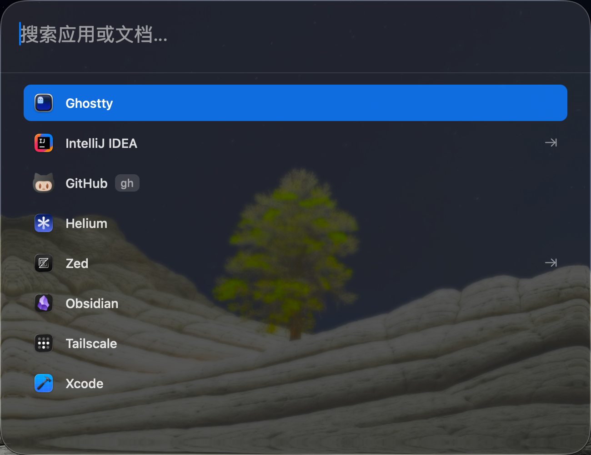

# LaunchX

English | [简体中文](README.zh-CN.md)

A modern, elegant, and intelligent macOS launcher. High-performance app and file search with rich extensions — double your Mac productivity.


**Search apps, files, bookmarks, clipboard history, and reminders; dispatch Claude Code / Codex — all starting from `⌥Space`.**

## Screenshot

<p align="center">
  
</p>

## Features

### Core

- **App Search** - Quickly find and launch applications, with English, Pinyin, Pinyin abbreviation, and fzf-style subsequence fuzzy matching
- **File Search** - High-performance file index with real-time FSEvents monitoring; select a file and press `⌘K` to cd into it, copy its path, reveal it in Finder, share via AirDrop, delete it, and more
- **Global Hotkeys** - Custom key combinations or double-tapped modifier keys (double `⌥`/`⌘`) to summon any app or advanced extension
- **Alias System** - Assign short aliases to any app, website, or extension (e.g. `gh` → GitHub, `cc` → Claude Code switcher); two or three keystrokes get you there
- **IDE Projects** - Quickly open recent projects from VSCode, Zed, Cursor, Antigravity, and JetBrains IDEs
- **Web Shortcuts** - Configure your favorite websites for one-click navigation or keyword-driven search
- **Recently Used** - LRU-based tracking of recently used apps, so favorites come first
- **Tool Management** - Every tool in one place: aliases, hotkeys, and enable toggles for all capabilities on a single list

### Advanced Extensions

- **Clipboard Manager** - Automatically records clipboard history (text, images, links, colors) with category filters, keyword search, paste-as-plain-text, and an ignore list for sensitive apps
- **Snippets** - Text auto-expansion with dynamic variables (`{date}`, `{time}`, `{uuid}`, etc.)
- **AI Translation** - Intelligent translation via multiple AI services; `⌥W` translates selected text instantly. Free models on SiliconFlow recommended to get started
- **Bookmark Search** - Import and search bookmarks from Safari, Chrome, and Helium, with automatic syncing
- **Reminders** - Shows today's reminders; open attached URLs instantly via `⌘K` when a note contains one
- **Claude Code Switcher (cc-switch)** - Type `cc` to bring up the switch panel; providers, context, MCP, and Skills are searchable and switchable — no more hand-editing config files
- **Codex Manager** - Same experience as cc-switch; one-click activation of preset role contexts. Auth is written to config.toml, so GUI launches keep environment variables intact
- **2FA Codes** - Automatically extracts verification codes from SMS (macOS versions below 26; newer systems have this built in)
- **System Commands** - Quickly run system commands (dark mode, lock screen, shutdown, empty Trash, hide Dock, and 10+ more)
- **Utilities** - Base64 encode/decode, IP lookup, URL handling, UUID generation, process quitting, and more
- **Default Terminal** - Launch your terminal in one keystroke; pair it with the folder `⌘K` "cd here" action to open working directories instantly
- **2 Built-in Key Remaps** - Swap single/double quotes, or remap right `⌘` to a Hyper key (F19); the caps/ctrl swap has been removed

## Installation

### Requirements

- macOS 14.0 or later

### Download

1. Download the latest `.dmg` from [Releases](https://github.com/twotwoba/LaunchX/releases) (native builds for both Apple silicon and Intel)
2. Open the DMG file and drag LaunchX into the Applications folder
3. Follow the in-app guidance on first launch to grant the required permissions

### Permissions

LaunchX needs the following system permissions to work properly:

| Permission | Purpose |
|------------|---------|
| **Accessibility** | Global hotkey registration, keyboard event monitoring, snippet auto-expansion |
| **Full Disk Access** | Indexing and searching all files, reading browser bookmarks |

A permission onboarding flow runs on first launch — just follow the prompts. All data is stored locally only.

## Getting Started

### Basics

1. **Summon the search panel** - Press `Option + Space` (customizable, or double-tap a modifier key)
2. **Search apps** - Type an app name; Pinyin, Pinyin abbreviations, and fuzzy matching are supported
3. **Launch** - Press `Enter` to open the selected item
4. **Navigate** - Use `↑` `↓` or `Ctrl+n/p` to move through results
5. **In-place actions** - With a file/folder selected, press `⌘K` to open the quick actions menu

### Shortcuts

| Shortcut | Action |
|----------|--------|
| `Option + Space` | Summon the main search panel (default) |
| `Enter` | Open the selected item |
| `↑` / `↓` or `Ctrl+n/p` | Move up/down |
| `Tab` | Expand IDE project list / switch focus |
| `⌘K` | Quick actions for files/folders (cd here, copy path, etc.) |
| `Esc` | Dismiss the panel |
| `Cmd + ,` | Open Settings |

### Aliases & Extension Triggers

Each extension can have its own alias and hotkey in Settings, for example:

- `cc` / `cx` - Claude Code / Codex switch panels
- `bk` - Bookmark search
- `⌥W` - AI translation of selected text
- Clipboard panel, default terminal, and more are all customizable

More features are on the way...

## Configuration

### Search Scope

Customizable in Settings:

- **App search scope** - Searches `/Applications`, `/System/Applications`, etc. by default
- **Document search scope** - Searches Downloads, Documents, and Desktop by default; external drive paths can be added
- **Excluded folders** - Such as `node_modules`, `dist`, etc.
- **Excluded apps** - Hide apps you don't need

### IDE Support

Recent projects are scanned automatically from:

- Visual Studio Code
- Zed
- Cursor
- Antigravity
- IntelliJ IDEA / PyCharm / WebStorm / GoLand and other JetBrains IDEs

### AI Setup

AI translation works with any OpenAI-compatible service:

- OpenAI (GPT), Anthropic (Claude), DeepSeek, Zhipu GLM, Alibaba Qwen, and more
- Services with free tiers such as SiliconFlow work out of the box
- Configure the API endpoint, key, and model in Settings

## Technical Architecture

- **Search Engine** - High-performance in-memory index built on a Trie prefix tree; repeated searches are free, with response times under 1 ms
- **File Monitoring** - FSEvents-based real-time file monitoring with change latency as low as 1.3 s
- **Hybrid Architecture** - AppKit + SwiftUI, lightweight locks instead of serial queues, non-critical work deferred
- **Persistence** - SQLite index database + JSON config files; all data stays on your machine

## Changelog

See [CHANGELOG.md](CHANGELOG.md) for the full release history.

## Development

### Tech Stack

- Swift 5.9
- SwiftUI + AppKit
- SQLite3
- Carbon Framework (global hotkeys)

### Project Structure

```
LaunchX/
├── App/                    # App entry point and panels
├── Models/                 # Data models
├── Services/               # Business logic services
│   └── SearchEngine/       # Search engine core
├── ViewModels/             # View models
├── Views/                  # UI views
└── Assets.xcassets/        # Asset catalog
```

## Community

If you have any suggestions, questions, or run into trouble, feel free to open an issue or reach me on WeChat: EricYuan228

## Contributing

Issues and Pull Requests are welcome!

## License

[Apache License 2.0](LICENSE)

## Acknowledgments

Thanks to all the open-source projects that inspired and helped this one.
